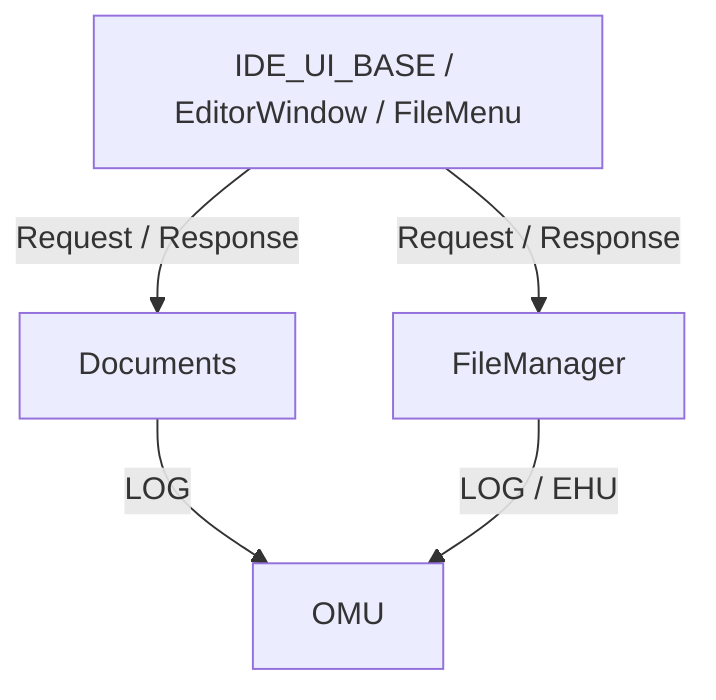

# PR(+Opt 1) — ArCD

版本：Cluster_Opt_1 / PR(+Opt 1)  
目標：參考舊 Cluster 純黑色 UI，實現可部署 GitHub Pages 的基本文件編輯器。

## 1. Object 清單

| ID | Object | 主要職責 | 黑箱狀態 |
|---|---|---|---|
| O01 | IDE_UI_BASE | 主頁、標頭、底部狀態列、分頁與事件適配 | DOM/UI 控制 |
| O02 | EditorWindow | 編輯文字、行號、游標位置 | 透過 UI 適配層管理 |
| O03 | FileMenu | 開啟檔案選單與命令分派 | DOM/UI 控制 |
| O04 | Documents | 建立、讀取、更新、關閉文件及 Dirty 狀態 | `#docs`, `#seq` 私有 |
| O05 | FileManager | 讀取 File、寫入 FileSystemFileHandle 或下載 | 不保留全域檔案資料 |
| O06 | OMU | 記錄操作、HTTP 類型狀態碼與 EHU 標記 | `#events` 私有 |

> Opt 1 是最小實作。EHU 以錯誤回應與 OMU 的 `ehu` 標記實現，尚未拆為獨立類別；Property/RelationRegistry、RelationshipTest 與 AIAGENTAPI 亦未獨立實作。

## 2. Property 清單

| Property | 內容 | 使用物件 |
|---|---|---|
| DOCUMENT | `{id,name,content,dirty,hasHandle}` 的資料副本 | UI / Documents |
| RESULT | `{ok,code,data,message}` | Documents / FileManager / UI |
| UI_THEME | `#000` 主編輯背景、`#202127` 標頭與狀態列 | UI / Editor |
| FILE_HANDLE | 瀏覽器 File System Access API handle（不向 UI 暴露） | Documents / FileManager |
| EVENT | `{id,time,source,action,code,message,ehu}` | OMU |

## 3. Event Chain 清單

| ID | Event Chain | 預期結果 |
|---|---|---|
| EC01 | FileMenu.New → Documents.create → UI.refresh | 建立空白分頁 |
| EC02 | FileMenu.Open → FileManager.open → Documents.create → UI.refresh | 開啟檔案並顯示內容 |
| EC03 | Editor.input → Documents.update → UI.refresh metadata | 內容修改、Dirty 狀態更新 |
| EC04 | FileMenu.Save → FileManager.save → Documents.setSaved | 儲存成功，Dirty 清除 |
| EC05 | FileMenu.Close → Dirty confirm → Documents.close → UI.refresh | 安全關閉分頁 |
| EC06 | Documents/FileManager → OMU.emit | 記錄事件碼及狀態 |

## 4. RQ/RP 錯誤處理清單（EHU）

| ID | RQ/RP 情境 | Code | 處理方式 |
|---|---|---|---|
| EH01 | 讀取不存在的 Document | 404 | 回傳錯誤，不修改狀態 |
| EH02 | 更新已關閉的 Document | 404 | 拒絕更新 |
| EH03 | 本地文件讀取失敗 | 500 | EHU LOG、保留其他文件 |
| EH04 | 使用者取消另存 | 400 | 安全取消、不清除 Dirty |
| EH05 | 儲存寫入失敗 | 500 | EHU LOG、保留內容與 Dirty |
| EH06 | 關閉未儲存文件 | 409（概念分類） | UI 確認後才關閉 |

HTTP 類型代碼僅作本地 OMU 事件分類，**不是** HTTP 服務器回傳碼。

## 5. Relationship Test 規劃

對每個 Request/Response 行為執行：RQ PASS、RQ FAIL、RP PASS、RP FAIL，紀錄 EHU / LOG / Dependency。

**Opt 1 尚未實作故障注入與完整四情境自動測試；不可標示為 PASS。**

## 6. Dependency

## 7. 交付與限制

- GitHub Pages 可部署的 HTML/CSS/JS ES Modules。
- 具備新增、讀取、編輯、關閉、儲存與另存功能；硬碟原始檔案刪除不包含在本版。
- 儲存時優先使用 `showSaveFilePicker`，不支援時改為下載檔案；下載不保證原路徑覆寫。
- UI 依照使用者截圖重建；未直接複製舊 GitHub Cluster 原始碼素材。
- 外部 HTTP API、AIAGENTAPI、完整黑箱 UI、持久化復原、關係測試引擎不在本版。
